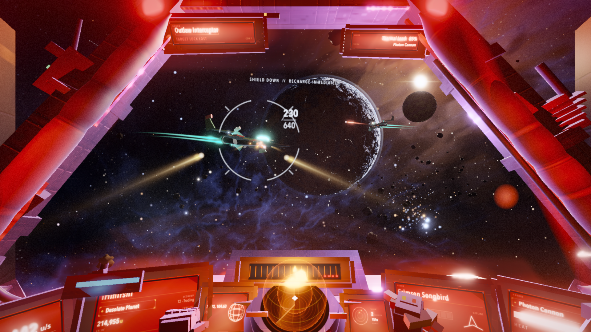
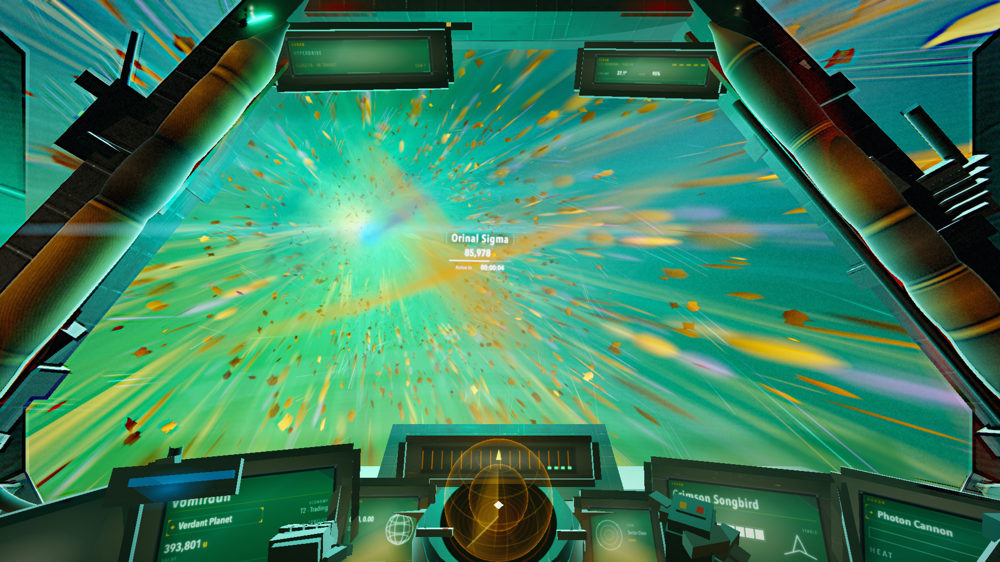
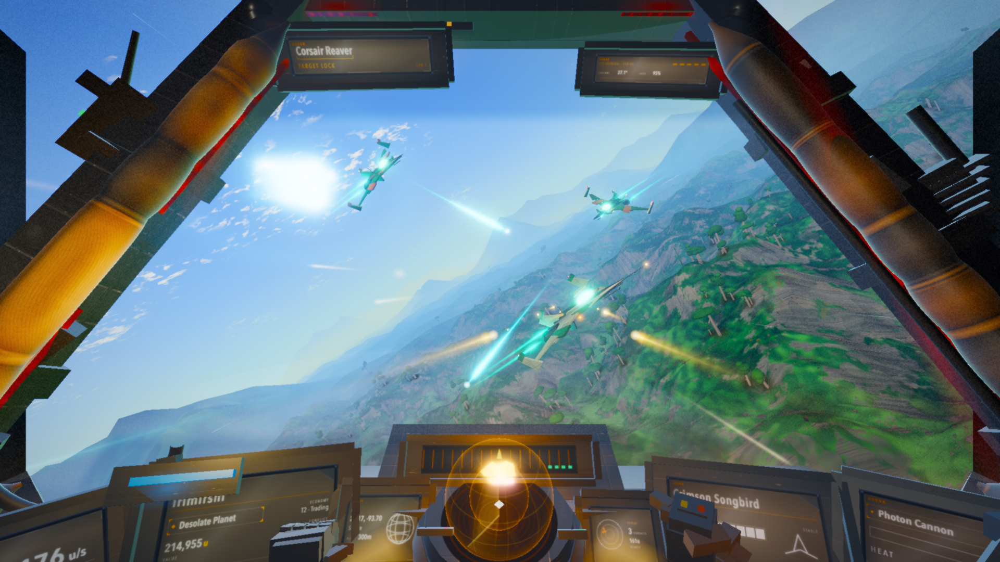
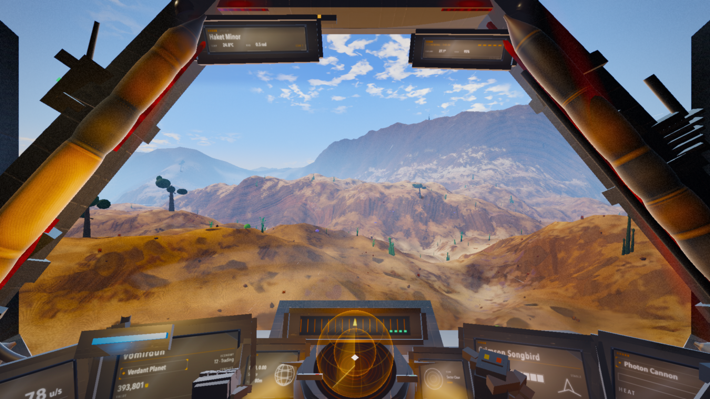

# Iridium Reach

A cockpit-view Star Trek fan space-combat demo, built almost entirely by AI
agents. Take the conn of a Starfleet vessel, hold the line against Klingon and
Romulan raiders, then dock at a friendly port to repair and refit before the
next jump.

Everything you see is procedural — every mesh, texture, planet, nebula and
sound effect is generated in code at runtime. No models, no image assets,
no audio files*, no build step. One HTML file, some ES modules, and three.js.

*except the ship's computer, who insisted on a real voice.

This is an unaffiliated fan tech demo. Star Trek and all related marks belong
to their respective owners; this project contains no assets from the franchise.

**[▶ Play it in your browser](https://jason-c-dev.github.io/iridium-reach-demo/)** — Chrome recommended, sound on.

## The game

Cruise a procedural sector, get ambushed by Klingon and Romulan raiders,
manage heat-limited phaser banks and a slow-loading photon torpedo, survive
the red alert, then jump to the next sector — each one harder than the last.
Every other sector is a safe haven where you can repair, resupply and upgrade.

- **Three hostile classes** — raiders, fast fragile scout craft, and a heavy
  battlecruiser that hits like a bailiff
- **Starfleet weapons** — sustained phaser banks plus a heavy photon torpedo
  with splash damage on a 3.2s reload
- **Ship systems** — shields that regenerate, a hull that doesn't, red
  alerts, and a ship you can genuinely lose
- **Safe havens** — friendly ports with no hostiles. Dock to patch the hull,
  recharge shields, upgrade torpedoes or buy phaser banks
- **Requisition credits** — earned from kills and wave clears, spent at port
- **Scoring** — per-kill and wave bonuses, persistent high score
- **Phaser upgrades** — every wave cleared doubles your heat endurance,
  MK I through MK IV, and the port sells the same upgrade if you have credits
- **Asteroids** — now with collision. Flying into rocks is no longer free
- **A ship's computer with attitude** — 49 voice lines across 16 events,
  performed in the finest tradition of sarcastic British AI. It will
  comment on your aim.

## Controls

| input | action |
|---|---|
| Mouse (hold LMB) | steer · phasers |
| RMB / Q | photon torpedo |
| W / S | impulse · brake |
| A / D | roll |
| Arrow keys | pitch · yaw |
| Shift | impulse boost |
| Space + Ctrl | brake-turn |
| F | phasers |
| E | dock at a safe haven |
| J | jump from safe space |
| Esc | pause · settings (mouse sensitivity, invert Y); returns to conn while docked |

## How it was built

This game was built by a **gauntlet loop**: a fleet of AI agents (Claude
Code — a Fable 5 orchestrator managing Opus 5 workers) given a task, a build
method, and a deliberately unreachable bar — *"indistinguishable from real
No Man's Sky screenshots to a forensic judge."* The game was originally built
as a No Man's Sky homage; this branch re-skins the cockpit, naming, HUD and
combat as a Star Trek fan demo.

Each round, worker agents rebuilt subsystems in parallel git worktrees, each
paired with a harsh critic; blind judges then compared screenshots of the
build against real reference shots and filed forensic defect reports, which
seeded the next round. Fifteen rounds and four runs later the judges were
still winning — that bar is unreachable by design — but along the way the
loop produced a complete playable game, a 60fps render pipeline, a
deterministic capture harness, and one genuinely fooled judge.

The full write-up — including what the technique gets right, where its
returns diminish, and why the human playtester out-found the critic fleet at
the end — is coming as a blog post.

## Demo honesty

This is a tech demo, and it knows it:

- The ship's computer is a little chatty. We measured it (64% speech duty in
  combat). It stays, because it adds to the charm.
- The asteroid belt only exists in the first system. After one warp, space
  is rock-free — the collision system arrived before the level design did.
- Safe havens are one-screen repair and requisition ports, not walkable
  station interiors.
- Targets 60fps at 1080p; measured grazing the bar on an Apple M4. Your
  mileage may vary with GPU and browser.
- Best experienced in Chrome. Audio starts after your first click (browser
  autoplay rules).

## Credits

- **Code**: built by [Claude Code](https://claude.com/claude-code) agents in
  a gauntlet loop, directed and playtested by
  [Jason Croucher](https://github.com/jason-c-dev). MIT licensed.
- **Rendering**: [three.js](https://threejs.org) (MIT, vendored).
- **Ship's computer**: voice lines generated with
  [ElevenLabs](https://elevenlabs.io) (voice: Callum). Distributed under
  ElevenLabs' terms, not MIT — see [LICENSE](LICENSE).
- **Inspiration**: the LCARS presentation and Starfleet combat are a fan
  tribute to [Star Trek](https://www.startrek.com/). The original visual and
  structural bar was [No Man's Sky](https://www.nomanssky.com/) by
  [Hello Games](https://hellogames.org/) — an amazing game the author plays
  and loves. This is an unaffiliated fan tech demo; it contains no assets from
  either franchise.
